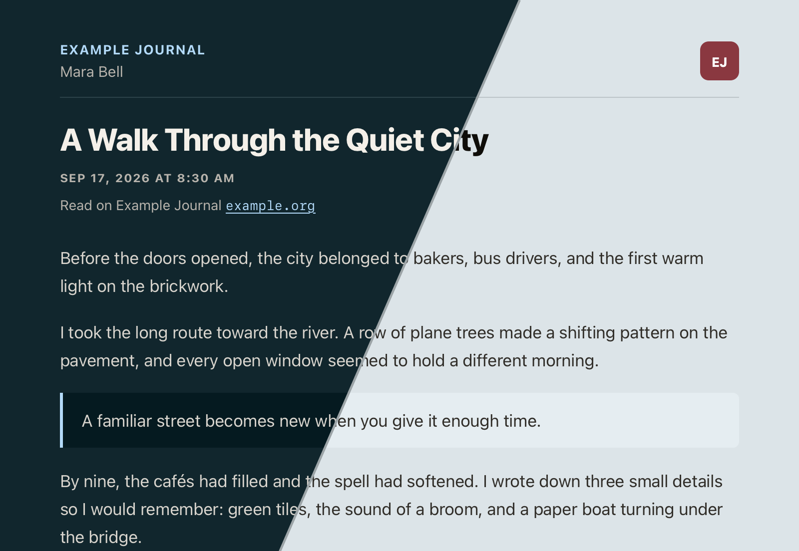

<!-- nnw-theme-identity:start -->
# Miniwinter

A NetNewsWire theme by [Rob Feldmann](https://robfeldmann.com).
<!-- nnw-theme-identity:end -->

The miniwinter palette for reading: cool blue-grey surfaces, warm ink, and azure links, in light and dark versions that follow your system appearance. It uses the system fonts and honors NetNewsWire's text size on macOS and Dynamic Type on iPhone and iPad.



## Install

Download the latest [`Miniwinter.nnwtheme.zip`](https://github.com/robfeldmann/nnwtheme-miniwinter/releases/latest):

- **macOS**: unzip it and double-click `Miniwinter.nnwtheme`, then confirm the install.
- **iPhone and iPad**: in Files, tap the `.zip` to expand it, then long-press `Miniwinter.nnwtheme` and share it to NetNewsWire. NetNewsWire opens the unzipped theme, not the zip.

Then choose **Miniwinter** as the article theme in NetNewsWire's settings.

## Development

The tooling is the [`nnw-theme`](https://github.com/dave-atx/nnw-theme) package, run through `npx` (Node.js 24 or later):

```sh
npx nnw-theme@2 preview   # live gallery that rebuilds on save
npx nnw-theme@2 check     # every fixture in WebKit, light and dark, plus packaging
```

The theme is `Miniwinter.nnwtheme/`; `fixtures/` holds extra sample articles.

`scripts/preview-image.sh` rebuilds `screenshots/theme-preview.png`, the README image and marketplace card, from the dark and light article renders (needs ImageMagick 7). `npx nnw-theme@2 screenshot --promote` and the Refresh marketplace screenshot workflow replace it with a single appearance, so rerun the script after either.

## Credits

- The colors are the miniwinter palette ("Icy winter") by [Evgeni Chasnovski](https://github.com/echasnovski), from [mini.nvim](https://github.com/nvim-mini/mini.nvim)'s `mini.hues` (MIT).
- The masthead and section-head layout take their cue from [Ember](https://github.com/dave-atx/ember-nnw-theme) by Dave Marquard, found through the [NetNewsWire Theme Marketplace](https://dave-atx.github.io/nnw-theme-marketplace/).
- The repository started from Dave Marquard's [NetNewsWire theme template](https://github.com/dave-atx/netnewswire-theme-template).

None of them is affiliated with this theme, and neither is NetNewsWire.

## License

The theme bundle is [0BSD](Miniwinter.nnwtheme/LICENSE); its [NOTICE](Miniwinter.nnwtheme/NOTICE) repeats the credits above. The repository files inherited from the template are [Apache-2.0](LICENSE).
